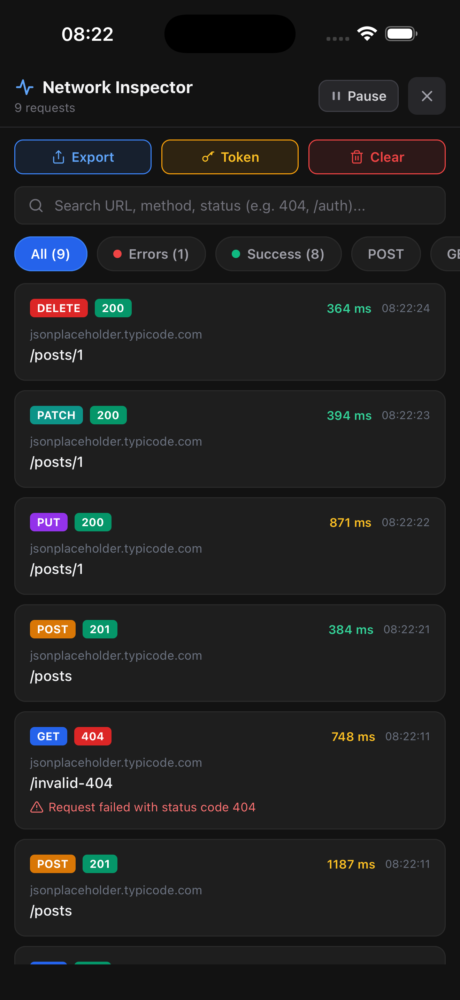
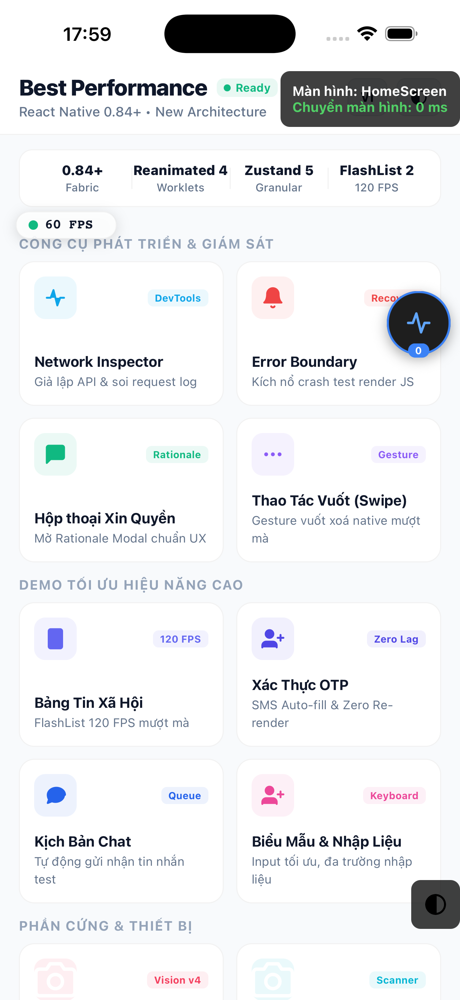
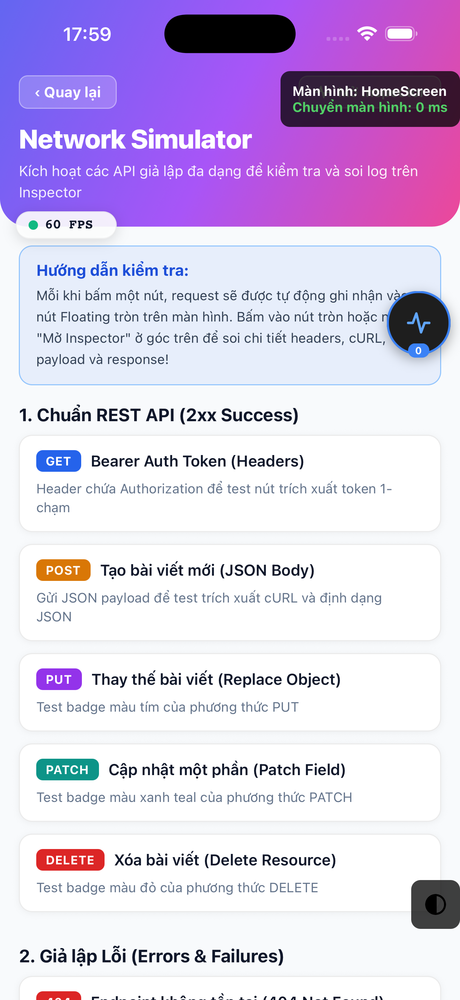
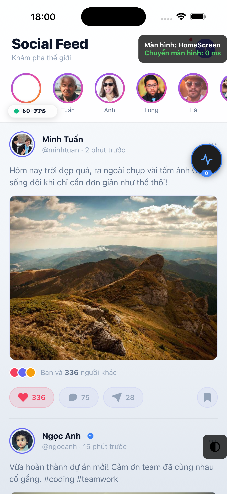
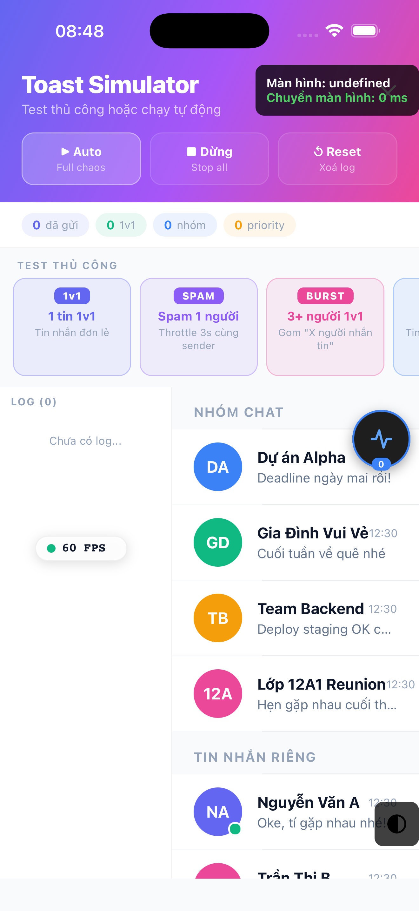
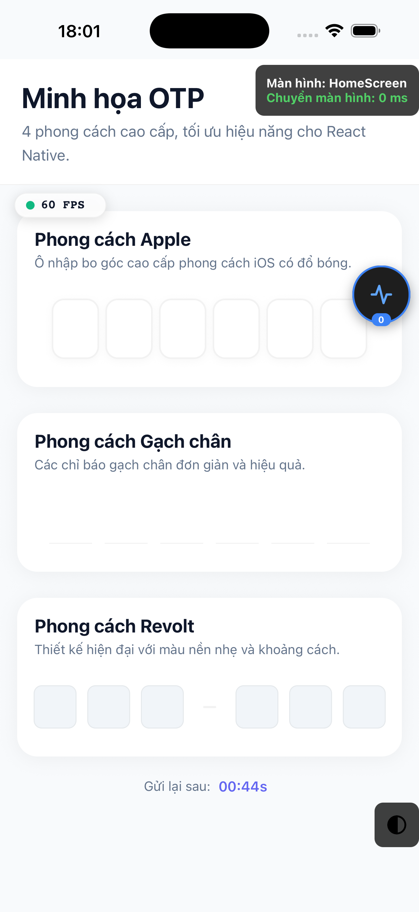
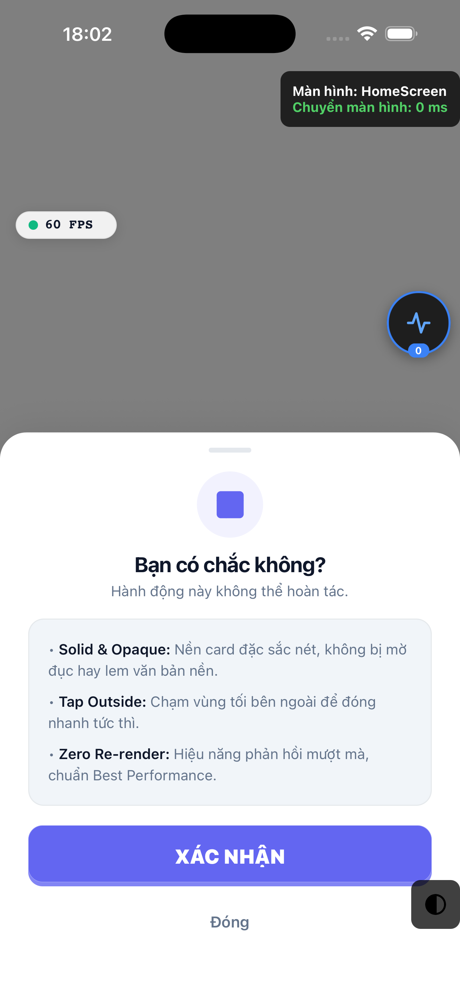

# 🚀 Tuấn's React Native Best Performance Template

> _"Đời dev đã ngắn, đừng tốn thêm 2 tuần setup project từ đầu rồi lại ngồi gãi đầu tự hỏi: 'Ủa sao máy khách giật lag thế nhờ?'"_  
> — **Tuấn**, Senior Mobile Dev đam mê 120 FPS ☕

<p align="center">
  <a href="https://reactnative.dev"></a>
  <a href="https://reactnative.dev"></a>
  <a href="https://docs.swmansion.com/react-native-reanimated/"></a>
  <a href="https://zustand-demo.pmnd.rs"></a>
  <a href="https://shopify.github.io/flash-list/"></a>
  <a href="https://www.typescriptlang.org"></a>
</p>

---

## ⚡ Tại sao bạn nên clone template này thay vì tự setup từ đầu?

Bạn chuẩn bị nhận một dự án React Native mới và sắp sửa:

1. 🥱 Chạy `npx @react-native-community/cli init` rồi dính lỗi build CocoaPods / Gradle kinh điển?
2. 🤯 Cài thêm Navigation, Reanimated, Theme, i18n, Storage, FCM, Splash... và mất trắng 3-5 ngày chỉ để giải quyết xung đột dependency?
3. 📉 Cắm vào máy Android cỏ 2-3 triệu rồi sốc nhiệt khi thấy FPS drop từ 60 xuống 18 vì code dính re-render thừa vô tội vạ?
4. 🕵️ Cần soi HTTP request mà Flipper sập, Charles Proxy thì đòi cài chứng chỉ SSL lằng nhằng?
5. 💥 App đột ngột crash trắng màn hình khiến khách hàng đánh giá 1 sao mà không biết lỗi ở đâu?

**DỪNG LẠI NGAY! Hãy để template này cứu rỗi thanh xuân của bạn.**

Đây là bộ **Starter Template React Native 0.84+ New Architecture (Fabric & Nitro Modules)** được đúc kết từ nhiều năm chinh chiến thực tế, tối ưu đến từng byte bộ nhớ và từng frame hình, với triết lý: **Clone về là chạy — Code là ra sản phẩm — Máy cỏ vẫn mượt 120 FPS.**

---

## 💎 Bảng tính năng nổi bật — Điểm sáng kiến trúc

| Tính năng nổi bật                            | Giá trị mang lại cho dự án                                                                                                                                                                                                                                                                                                     | Trạng thái |
| -------------------------------------------- | ------------------------------------------------------------------------------------------------------------------------------------------------------------------------------------------------------------------------------------------------------------------------------------------------------------------------------ | :--------: |
| 🕵️ **In-App Requests Inspector (Local Lib)** | **Vũ khí bí mật số 1!** Soi full traffic HTTP/HTTPS trực tiếp ngay trong app (REST API, request/response payload, latency ms, status 2xx/4xx/5xx). Bong bóng nổi kéo thả hít mép, **Copy cURL 1 chạm**, bóc tách Bearer token, search & filter siêu tốc — hoàn toàn zero external dependency (`src/libs/requests-inspector/`). |     ✅     |
| 🚀 **React Native 0.84+ New Architecture**   | Bật sẵn **Fabric Renderer** & **TurboModules / Nitro Modules**. Tốc độ native JSI trực tiếp, không phụ thuộc Bridge cũ kỹ.                                                                                                                                                                                                     |     ✅     |
| ⚡ **Zero Re-render Architecture**           | Áp dụng triệt để Reanimated 4 Worklets, `useImperativeHandle`, `memo` comparators. Countdown OTP, Timer quay phim, Draggable HUD chạy 100% trên UI Thread — JS Thread rảnh rỗi tuyệt đối!                                                                                                                                      |     ✅     |
| 📊 **Real-time DevHUD (FPS & Nav Speed)**    | Widget nổi hợp nhất đo **UI Thread FPS (60/120Hz)** và **thời gian chuyển trang (ms)**. Kéo thả tự do, tap mở rộng xem full screen name và **Copy 1 chạm**, zero re-render JS!                                                                                                                                                 |     ✅     |
| 🧩 **Interactive Component Gallery**         | Màn hình tra cứu & test trực tiếp toàn bộ UI/UX components trong repo (3D Buttons, Ripple Touch, Modals, DevTools...). Phân loại trực quan, demo live tương tác tức thì!                                                                                                                                                       |     ✅     |
| 🛡️ **Zero-Dependency Error Boundary**        | Khi có lỗi render JS bất ngờ, thay vì sập app văng ra màn hình chính, app tự động kích hoạt **Crash Recovery Screen** hiển thị chi tiết stack trace, nút Copy Crash Log và Thử lại / Khởi động lại app an toàn.                                                                                                                |     ✅     |
| 🔑 **Universal Permission Rationale Modal**  | Modal xin quyền hệ thống (Camera, Micro, Thư viện, Thông báo) giao diện cao cấp, giải thích lý do trước khi kích hoạt native prompt. Tự động hỗ trợ mở App Settings nếu quyền bị từ chối vĩnh viễn.                                                                                                                            |     ✅     |
| 🛠️ **Scaffolding Screen Generator**          | Lệnh thần thánh `yarn gen:screen <ScreenName>` sinh mã tự động cả màn hình, styles chuẩn Responsive, Dark/Light theme, tự add route navigation và i18n trong **0.5 giây**!                                                                                                                                                     |     ✅     |
| 🎨 **Theme System 3 Trạng thái**             | Hỗ trợ ☀️ **Sáng (Light)**, 🌙 **Tối (Dark)** và ⚙️ **Hệ thống (Auto)** thông minh theo `Appearance`. Đổi theme mượt mà toàn diện không giật cục với floating switch capsule.                                                                                                                                                  |     ✅     |
| 💬 **Chat Toast Aggregator (>150 msg/min)**  | Thuật toán gom cụm thông báo chat cực hạn kiểu Zalo: sliding window, per-group tracking, burst detection, mention xuyên throttle — không bao giờ spam tràn ngập màn hình.                                                                                                                                                      |     ✅     |
| 📱 **Responsive Scaling 100%**               | Bộ hàm `s()`, `vs()`, `ms()`, `fs()` quy chuẩn theo chuẩn iPhone 14, tự động co giãn hoàn hảo trên mọi kích thước màn hình từ iPhone SE đến iPad/Tablet.                                                                                                                                                                       |     ✅     |
| 🚀 **FlashList 2.x & SuperGallery**          | Danh sách lướt cuộn 120 FPS tải hàng ngàn items không drop frame. Trình xem ảnh full-screen pinch-to-zoom + swipe dismiss không re-render parent.                                                                                                                                                                              |     ✅     |
| 🔢 **Premium OTP System**                    | 4 style OTP đẳng cấp (Stripe, Apple, Dashed, Revolt), SMS Auto-fill, Countdown Reanimated chạy 100% trên UI thread.                                                                                                                                                                                                            |     ✅     |
| 🤖 **Built-in AI Agent Skills**              | Tích hợp sẵn bộ quy chuẩn `.agents/skills/rn-best-performance-dev` giúp Antigravity, Cursor, Claude Code sinh mã chuẩn kiến trúc template 100%.                                                                                                                                                                                |     ✅     |

---

## 📸 Giao diện thực tế (Screenshots từ Simulator / Real Device)

|                      🕵️ Vũ khí số 1: In-App Network Inspector (Full API Traffic)                       |                        🏠 Trang chủ Bento Grid & Thông số Kỹ thuật                         |
| :----------------------------------------------------------------------------------------------------: | :----------------------------------------------------------------------------------------: |
|  |  |
|        _Soi full request/response, Copy cURL 1 chạm, bóc Bearer token, search & filter status_         |             _Bento Grid hiện đại, Tech Specs bar, theme switcher 3 trạng thái_             |

|                      🌐 Network API Simulator (12 Kịch Bản & Stress Blast)                      |                       🚀 FlashList 120 FPS Infinite Feed & Stories                        |
| :---------------------------------------------------------------------------------------------: | :---------------------------------------------------------------------------------------: |
|  |  |
|              _Mô phỏng 12 kịch bản mạng thực chiến, bong bóng nổi kéo thả hít mép_              |               _Infinite scrolling siêu mượt, story bar Reanimated progress_               |

|                 💬 Realtime Chat & High-Stress Tester (>150 msg/min)                  |                   🔢 Zero Re-render OTP & Bộ đếm UI Thread                    |
| :-----------------------------------------------------------------------------------: | :---------------------------------------------------------------------------: |
|  |  |
|      _Stress test dội bom tin nhắn, Initial Avatar & Badge chống lỗi font/emoji_      |        _4 phong cách OTP cao cấp, countdown chạy 100% trên UI thread_         |

|                              🪟 Native Bottom Sheet Modal Screen                               |
| :--------------------------------------------------------------------------------------------: |
|  |
|                _Modal solid card bo góc, grabber pill, backdrop tap to dismiss_                |

---

## 🛠️ Scaffolding Generator Script — Sinh Code Màn Hình Thần Tốc

Bạn mệt mỏi vì mỗi lần tạo màn hình mới phải: tạo folder, tạo file tsx, tạo file styles, import `useStyles`, copy paste boilerplate, rồi mò vào `AppNavigation.tsx` khai báo route, rồi mò vào `vi.json`/`en.json` thêm key?

Chỉ cần một câu lệnh duy nhất:

```bash
yarn gen:screen <ScreenName>
```

### 🎯 Ví dụ thực tế:

```bash
# Tạo màn hình Profile
yarn gen:screen Profile

# Hoặc tạo màn hình OrderDetail
yarn gen:screen OrderDetail
```

### ⚡ Script sẽ tự động thực hiện 5 việc trong 0.5 giây:

1. 📁 **Tạo Component Màn hình (`src/screens/orderDetail/OrderDetailScreen.tsx`)**:

   - Tự bọc trong `AppScreen` với safe area chuẩn chỉ.
   - Gắn sẵn hook `useStyles` reactive theo theme tokens.
   - Gắn `useRenderLog` để soi re-render ngay khi code.
   - Bọc `React.memo` chuẩn zero re-render.
   - Tạo sẵn nút bấm mẫu dùng `AppButton` 3D depth và `toast`.

2. 🎨 **Tạo File Styles (`src/screens/orderDetail/OrderDetailScreen.styles.ts`)**:

   - Sử dụng hàm chuẩn responsive: `s()`, `vs()`, `ms()`, `fs()`.
   - Kết nối trực tiếp với bảng màu `AppTheme`.

3. 🧭 **Tự động đăng ký Route vào Navigation**:

   - Tự động thêm `import OrderDetailScreen` vào `src/navigation/AppNavigation.tsx`.
   - Tự động chèn route vào `MainStack` với header chuẩn.

4. 🌍 **Tự động thêm i18n Key**:

   - Tự thêm bản dịch vào cả `src/i18n/locales/vi.json` và `src/i18n/locales/en.json`.

5. ✨ **Tự động format chuẩn Prettier**:
   - Code sinh ra bóng bẩy, thụt lề chuẩn, không cần format lại bằng tay.

Sau khi lệnh chạy xong, bạn chỉ việc gọi ngay:

```tsx
NavigationService.navigate('OrderDetailScreen');
```

---

## 📁 Cấu trúc Source Code

```
template/
├── .agents/                   # 🤖 Bộ kỹ năng AI Agent tích hợp
│   └── skills/
│       └── rn-best-performance-dev/ # Quy chuẩn code, zero re-render, git commit
├── scripts/                   # 🛠️ Bộ công cụ tự động hóa phát triển
│   └── genScreen.js           #     Scaffolding screen generator (yarn gen:screen)
├── docs/                      # 📚 Tài liệu & screenshots thực tế
│   └── screenshots/           #     Ảnh chụp màn hình từ Simulator/Device
├── App.tsx                    # 🏠 Entry point — sạch sẽ, bao bọc bởi AppProvider
├── index.js                   # 📌 Đăng ký app
├── build.sh                   # 🏗️ Script build multi-env (dev/prod)
│
├── src/
│   ├── api/                   # 🌐 API Layer
│   │   ├── apiClient.ts       #     Axios client (tự động gắn requests-inspector)
│   │   └── endpoints.ts       #     Danh sách API endpoints
│   │
│   ├── assets/                # 🎨 Tài nguyên tĩnh
│   │   ├── icon/              #     ✨ SVG Icon System (react-native-svg, độc lập, không lỗi font)
│   │   ├── images/            #     Hình ảnh tĩnh
│   │   └── logo.png           #     Logo ứng dụng
│   │
│   ├── components/            # 🧩 Components tái sử dụng
│   │   ├── portals/           #     Components toàn cục treo trên root
│   │   │   ├── AppProvider.tsx         # Provider tổng: SafeArea, ErrorBoundary, FpsHUD, Modal, FCM...
│   │   │   ├── FpsHUD.tsx              # 📊 Draggable DevHUD đo FPS UI Thread + Nav Speed + Copy Screen
│   │   │   ├── ButtonSwitchTheme.tsx   # 🎨 Floating pill chuyển 3 chế độ Theme
│   │   │   ├── GlobalLoadingComponent  # Loading overlay chặn tương tác toàn app
│   │   │   └── alert/                  # Custom Alert + Toast system (không phụ thuộc thư viện)
│   │   │
│   │   └── ui/                #     UI Kit hiệu năng cao
│   │       ├── appScreen/     #     Khung màn hình chuẩn, tự tính safe area insets
│   │       ├── appButton/     #     Button 3D với depth effect và spring physics
│   │       ├── appPress/      #     Pressable với ripple animation tối ưu cao
│   │       ├── appImage/      #     Image 3-layer (skeleton → thumbnail → full)
│   │       ├── skeleton/      #     Skeleton loading placeholder
│   │       ├── superGallery/  #     🖼️ Full-screen image viewer (zoom + swipe)
│   │       ├── superBanner/   #     Carousel auto-play với parallax
│   │       ├── swipeItem/     #     🖐️ Swipeable Item (Gesture + Reanimated 4)
│   │       └── toast/         #     💬 ChatToastManager + ChatToastContainer
│   │
│   ├── libs/                  # 📦 Thư viện nội bộ độc lập (Local Libraries)
│   │   ├── requests-inspector/#     🕵️ In-app Network Inspector (Floating bubble, cURL copy, token copy)
│   │   ├── error-boundary/    #     🛡️ Local Error Boundary & Crash Recovery Screen
│   │   └── permissions/       #     🔑 Universal Permission Rationale Modal & Hook
│   │
│   ├── navigation/            # 🧭 Điều hướng
│   │   ├── AppNavigation.tsx  #     Stack navigator (React Navigation v8 Static API)
│   │   └── NavigationService  #     navigate(), push(), replace(), back() — gọi ở mọi nơi
│   │
│   ├── screens/               # 📱 Màn hình ứng dụng
│   │   ├── home/              #     Trang chủ Bento Grid, Tech Specs, Bottom Sheet Modal
│   │   ├── componentGallery/  #     🧩 Thư viện tra cứu & demo toàn bộ UI components
│   │   ├── networkSimulator/  #     🌐 Mô phỏng 12 kịch bản API thực tế + Concurrent Blast
│   │   ├── chatDemo/          #     💬 Màn hình chat 1v1 & nhóm thực chiến
│   │   ├── chatSimulator/     #     🧪 Giả lập dội bom tin nhắn (>150 msg/min)
│   │   ├── camera/            #     📸 Pro Camera Module (Nitro Modules, Tap-to-focus)
│   │   ├── qrScan/            #     🔍 QR/Barcode Scanner (Flashlight, Gallery scan)
│   │   ├── otp/               #     🔢 Premium OTP input (4 styles, Zero re-render timer)
│   │   └── swipeable/         #     🖐️ FlashList 120 FPS + Swipe-to-action
│   │
│   ├── store/                 # 🗃️ State Management (Zustand 5)
│   │   ├── useLoadingStore    #     Global loading state (gọi được ngoài component)
│   │   ├── useNavigationStore #     Track màn hình hiện tại + thời gian chuyển ms
│   │   └── useThemeStore      #     Theme state: 'light' | 'dark' | 'auto'
│   │
│   ├── theme/                 # 🎨 Design System
│   │   ├── Colors.ts          #     Theme tokens (light / dark)
│   │   ├── Responsive.ts      #     Scale functions: s(), vs(), ms(), fs()
│   │   └── useStyles.ts       #     Hook tạo styles reactive theo theme
│   │
│   ├── types/                 # 📝 TypeScript types
│   └── utils/                 # 🔧 Utilities
```

---

## 🚀 Bắt đầu nhanh

### Yêu cầu môi trường

- **Node.js** >= 22.11.0
- **Yarn** (khuyến nghị)
- **Xcode** (cho iOS) / **Android Studio** (cho Android)
- Đã hoàn tất [React Native Environment Setup](https://reactnative.dev/docs/set-up-your-environment)

### 1️⃣ Clone & Cài đặt

```bash
# Clone repo về máy
git clone <repo-url> my-awesome-app
cd my-awesome-app

# Cài đặt toàn bộ dependencies
yarn install

# Cấu hình Node cho Xcode (bước này cực quan trọng trên macOS! ⚠️)
echo "export NODE_BINARY=$(which node)" > .xcode.env.local
```

### 2️⃣ Cài đặt CocoaPods (iOS)

```bash
bundle install                    # Cài Ruby bundler lần đầu
bundle exec pod install           # Cài native pods
```

### 3️⃣ Chạy ứng dụng

```bash
# Khởi động Metro bundler
yarn start

# --- Mở một tab terminal mới ---

# 🍎 Chạy trên iOS Simulator (tự động chuyển môi trường Dev)
yarn ios

# 🤖 Chạy trên Android Emulator (tự động chuyển môi trường Dev)
yarn android
```

> 💡 **Bí kíp**: Lệnh `yarn ios` và `yarn android` đã tự động kích hoạt script `build.sh` để switch sang môi trường **Development** (Firebase config, app name, package name). Bạn không cần động tay vào cấu hình native!

---

## 🎯 Chi tiết các "Vũ khí hạng nặng"

### 🕵️ 1. In-App Requests Inspector (Local Library)

Nằm tại `src/libs/requests-inspector/` (đã được bóc tách và tích hợp trực tiếp, không phụ thuộc npm ngoài):

- **Tự động bắt request**: Đã được gắn vào `apiClient.ts` qua `attachRequestsInspector(apiClient)`. Toàn bộ REST API, status 2xx/4xx/5xx, duration ms đều hiển thị trực quan.
- **Bong bóng nổi di động**: Tự động hít vào mép màn hình trái/phải, hiển thị badge số lượng request mới, kéo thả không giật lag.
- **1-Tap Quick Actions**:
  - 📋 **Copy cURL**: Tạo lệnh `curl -X POST ...` chuẩn chỉnh chỉ với 1 cú chạm để paste ngay vào Terminal / Postman.
  - 🔑 **Copy Bearer Token**: Tự động bóc tách token từ header `Authorization: Bearer <token>`.
  - 📄 **Copy JSON Payload/Response**: Đã format sẵn thụt lề đẹp đẽ, gửi thẳng cho Backend dev đối soát.
- **Bộ lọc thông minh**: Tìm kiếm theo URL, lọc theo Method (`GET`, `POST`, `PUT`, `DELETE`...) hoặc Status code (`2xx`, `4xx`, `5xx`).

### 📊 2. Draggable Real-time FPS & Memory HUD

Nằm tại `src/components/portals/FpsHUD.tsx`, được nhúng sẵn tại root `AppProvider`.

- **Cơ chế đo**:
  - **UI Thread FPS**: Tính toán trực tiếp bằng Reanimated Worklet đo delta timestamp giữa các frame hình native.
  - **JS Thread FPS**: Đo tần số dispatch event từ JS event loop.
  - **RAM Memory**: Đo dung lượng memory heap theo thời gian thực.
- **Zero Re-render**: Toàn bộ giá trị FPS và text được update trực tiếp qua `AnimatedTextInput` và Reanimated SharedValues. Component cha và các màn hình bên dưới **không hề bị re-render** khi số FPS nhảy liên tục!
- **Kéo thả tự do**: Dùng `react-native-gesture-handler` cho phép kéo widget đến bất kỳ vị trí nào trên màn hình, vị trí mặc định nằm góc dưới bên trái tránh đè header màn hình.

### 🛡️ 3. Zero-Dependency Error Boundary & Crash Recovery Screen

Nằm tại `src/components/portals/errorBoundary/`.

- **Vấn đề thực tế**: Trong React Native, một lỗi JS bất ngờ (ví dụ: `Cannot read properties of undefined`) sẽ làm sập app ngay lập tức (Crash to Home), khách hàng không hiểu chuyện gì xảy ra.
- **Giải pháp**: Bọc toàn bộ ứng dụng bằng `AppErrorBoundary`. Khi phát sinh exception:
  - Tự động bắt lỗi ở lifecycle `componentDidCatch`.
  - Hiển thị màn hình phục hồi **Crash Recovery Screen** cực kỳ chỉn chu.
  - Cung cấp nút **Copy Crash Log** (kèm full component stack) để gửi cho đội ngũ dev.
  - Cung cấp nút **Thử lại** hoặc **Khởi động lại ứng dụng** an toàn.
  - **Hoàn toàn độc lập**, không phụ thuộc vào thư viện bên thứ 3 nào.

### 🔑 4. Universal Permission Rationale Modal & Hook

Nằm tại `src/components/portals/permission/`.

- **UX chuẩn Apple / Google**: Tuyệt đối không gọi thẳng native permission popup mà không báo trước cho người dùng.
- **Hook `usePermission` & `showPermissionRationaleModal`**:

  ```tsx
  import { showPermissionRationaleModal } from '@/components/portals/permission/PermissionRationaleModal';

  // Hiện modal giải thích trước khi xin quyền
  showPermissionRationaleModal({
    permissionType: 'camera',
    title: 'Quyền sử dụng Máy ảnh',
    description:
      'Ứng dụng cần quyền Camera để bạn có thể quét mã QR thanh toán và chụp ảnh tài liệu.',
    onConfirm: async () => {
      // Gọi lệnh request permission native
    },
    onCancel: () => {
      // Người dùng chưa đồng ý
    },
  });
  ```

- **Hỗ trợ Settings Redirection**: Nếu người dùng đã chọn "Don't ask again" (Android) hoặc từ chối vĩnh viễn (iOS), modal tự động hiển thị nút **Mở Cài đặt** (`Linking.openSettings()`).

### 🎨 5. Theme System 3 Trạng thái (Light / Dark / Auto)

Hệ thống theme token được quản lý bởi Zustand qua `src/store/useThemeStore.ts`:

```tsx
import { useThemeStore } from '@/store/useThemeStore';

const mode = useThemeStore(state => state.mode); // 'light' | 'dark' | 'auto'
const setMode = useThemeStore(state => state.setMode);

// Chuyển sang Light
setMode('light');

// Chuyển sang Dark
setMode('dark');

// Chuyển sang Tự động theo hệ thống máy (Appearance)
setMode('auto');
```

Mọi component sử dụng hook `useStyles(createStyles)` sẽ tự động re-render và đổi màu mượt mà khi theme thay đổi.

---

## 📋 Các lệnh hữu ích

### 🏃 Chạy & Phát triển

| Lệnh                     | Mô tả                                                      |
| ------------------------ | ---------------------------------------------------------- |
| `yarn start`             | Khởi động Metro bundler (tự reset cache)                   |
| `yarn ios`               | Build & chạy iOS Simulator (Môi trường Dev)                |
| `yarn android`           | Build & chạy Android Emulator (Môi trường Dev)             |
| `yarn ios-live`          | Build & chạy iOS (Môi trường Production)                   |
| `yarn android-live`      | Build & chạy Android (Môi trường Production)               |
| `yarn gen:screen <Name>` | 🛠️ **Sinh mã tự động Screen + Styles + Navigation + i18n** |

### 📦 Đóng gói & Release

| Lệnh                     | Mô tả                                                       |
| ------------------------ | ----------------------------------------------------------- |
| `yarn android-build-APK` | Build file APK Release (tự động đặt tên file theo ngày giờ) |
| `yarn android-build-AAB` | Build file AAB Release để tải lên Google Play Console       |
| `yarn open-folder-apk`   | Mở thư mục chứa file APK đã build trên máy                  |
| `yarn open-folder-aab`   | Mở thư mục chứa file AAB đã build trên máy                  |
| `yarn export-all`        | Export bundle cho cả Android và iOS                         |

### 🧹 Dọn dẹp & Sửa lỗi Native

| Lệnh                 | Mô tả                                                                     |
| -------------------- | ------------------------------------------------------------------------- |
| `yarn clean:android` | Dọn dẹp Gradle cache và build cache Android                               |
| `yarn clean:ios`     | Nuclear clean iOS (Xóa sạch Pods, DerivedData, Podfile.lock và build lại) |

### 🔧 Chất lượng mã nguồn (Code Quality)

| Lệnh              | Mô tả                                                        |
| ----------------- | ------------------------------------------------------------ |
| `yarn lint`       | Kiểm tra toàn bộ mã nguồn bằng ESLint                        |
| `yarn lint:fix`   | Tự động sửa các lỗi cú pháp và sắp xếp import                |
| `yarn lint:check` | Kiểm tra nghiêm ngặt không cho phép warning (dùng cho CI/CD) |

---

## 🧰 Tech Stack chi tiết

| Công nghệ                | Phiên bản   | Vai trò & Giá trị                                                                                  |
| ------------------------ | ----------- | -------------------------------------------------------------------------------------------------- |
| **React Native**         | 0.84.0      | Framework di động thế hệ mới, bật sẵn New Architecture                                             |
| **React**                | 19.2.3      | Thư viện UI nền tảng                                                                               |
| **TypeScript**           | 5.8+        | Strict mode 100%, bảo đảm an toàn kiểu dữ liệu                                                     |
| **Reanimated**           | 4.2.2       | Thư viện diễn hoạt hiệu năng cao chạy trên UI Thread                                               |
| **FlashList (@shopify)** | 2.2.x       | Danh sách tái sử dụng cell cực nhanh, đạt chuẩn 120 FPS                                            |
| **Zustand**              | 5.x         | Quản trị state nhẹ, nhanh, gọi trực tiếp được cả bên ngoài React tree                              |
| **React Navigation**     | 8.x (alpha) | Điều hướng toàn diện với Static API mới nhất                                                       |
| **Gesture Handler**      | 2.30.x      | Bắt cử chỉ vuốt, kéo, zoom mượt mà ở tầng native                                                   |
| **Vision Camera**        | 5.0.x       | Pro Camera Module với Nitro Modules JSI siêu tốc                                                   |
| **MMKV**                 | 4.1.x       | Lưu trữ key-value siêu tốc, nhanh gấp 30 lần AsyncStorage                                          |
| **Firebase Messaging**   | 23.8.x      | Push notifications đa nền tảng với Modular API v23                                                 |
| **Notifee**              | 9.1.x       | Thông báo nội bộ (Local notifications)                                                             |
| **Keyboard Controller**  | 1.20.x      | Đồng bộ bàn phím native giữa iOS và Android                                                        |
| **React Native SVG**     | 15.15.x     | Hệ thống vector icon nội bộ, loại bỏ hoàn toàn lỗi font vỡ icon                                    |
| **Requests Inspector**   | Local       | Thư viện in-app HTTP/HTTPS network debugger (`src/libs/requests-inspector/`)                       |
| **Error Boundary**       | Local       | Hệ thống bắt crash JS và màn hình phục hồi cứu hộ (`src/components/portals/errorBoundary/`)        |
| **FPS HUD**              | Local       | Widget đo FPS UI/JS Thread và RAM thời gian thực (`src/components/ui/fpsHud/`)                     |
| **Permission Modal**     | Local       | Modal xin quyền hệ thống thân thiện kèm điều hướng Settings (`src/components/portals/permission/`) |
| **AI Agent Skills**      | Built-in    | Bộ quy chuẩn `.agents/skills/rn-best-performance-dev` hỗ trợ AI assistant                          |

---

## 💝 Lời nhắn từ tác giả

Tôi là **Tuấn** — một Mobile Developer đam mê mã nguồn mở và luôn tôn sùng tiêu chuẩn **hiệu năng cao**. Template này không chỉ là tập hợp code mẫu, mà là tinh hoa đúc kết từ hàng chục dự án lớn nhỏ, những đêm thức trắng săn tìm từng frame hình bị drop, và mong muốn giúp cộng đồng dev Việt Nam có một nền móng vững chắc nhất khi bước vào kỷ nguyên **React Native New Architecture**.

Nếu template này giúp bạn tiết kiệm dù chỉ vài ngày setup hay cứu được một dự án thoát khỏi cảnh lag giật, thì đó là niềm hạnh phúc lớn nhất của tôi! 🎉

> _"Code ít, làm nhiều. Setup chuẩn một lần, dùng thong dong cả đời."_  
> — **Tuấn** 🚀

---

## 📄 License

Phát hành dưới giấy phép mã nguồn mở **MIT License**.  
Made with ❤️ and ☕ by **Tuấn** ([@tuan1996v2](https://github.com/tuan1996v2)).

<div align="center">

**⭐ Nếu thấy hữu ích, đừng ngần ngại tặng 1 Star cho repo nhé! ⭐**  
_Mỗi ngôi sao của bạn là động lực để tôi tiếp tục bảo trì và cập nhật các tính năng đỉnh cao!_ 😊

</div>
